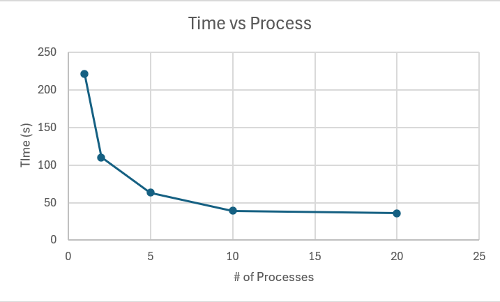

# READ ME FILE FOR LAB11 

## The code implementation 
In order to create a program that was able to alter the number of processes running based off of a starting parameter put into the command line, I only used children of one parent. This allows me to use a control variable that initializes all the processes up front in a for loop before proceeding to doing computation.

In the program their are two hard coded macros, one that set the desired final scale, and one that controlled how much we decrement with each iteration. The main bulk of the process works with two shared memory variables using MMAP, one to count how many frames were generated and one that updates the next frames scale and is read from. In order to prevent a race condition from happening I used a semaphore to block access to the shared memory variables when another process is accessing it. Finally, in order to run the mandel exe file with the correct values for the next frame generation I use a the execve function that allows for a program to run a executable file and also enter values for that files argv. With all those factors working smoothly in a while loop the next movie is able to be speedily generated.

## Speed Graph
