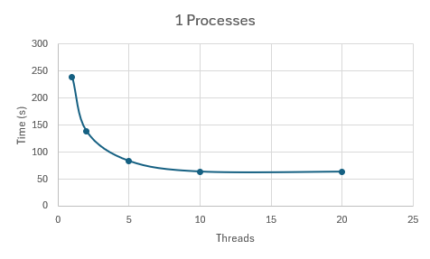
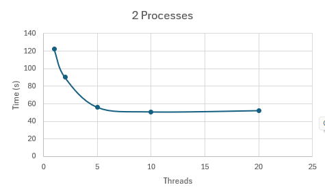
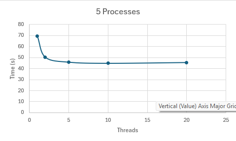
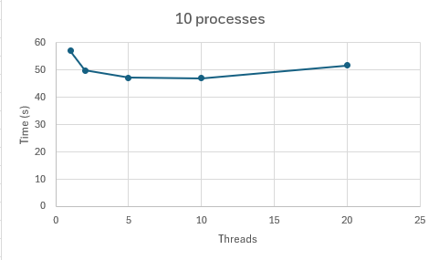
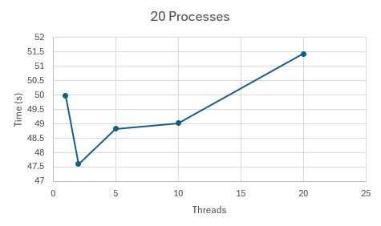

# READ ME FILE FOR LAB11 

## The code implementation 
In order to create a program that was able to alter the number of processes running based off of a starting parameter put into the command line, I only used children of one parent. This allows me to use a control variable that initializes all the processes up front in a for loop before proceeding to doing computation.

In the program their are two hard coded macros, one that set the desired final scale, and one that controlled how much we decrement with each iteration. The main bulk of the process works with two shared memory variables using MMAP, one to count how many frames were generated and one that updates the next frames scale and is read from. In order to prevent a race condition from happening I used a semaphore to block access to the shared memory variables when another process is accessing it. Finally, in order to run the mandel exe file with the correct values for the next frame generation I use a the execve function that allows for a program to run a executable file and also enter values for that files argv. With all those factors working smoothly in a while loop the next movie is able to be speedily generated.

## Speed Graph

## Lab 12 Implementation
In order to incorporate threads into processing a mandela image, I created a thread creation for loop that computes a 1000/N columns for N threads. In order to pass the correct values to the compute_image function I had to create a structure called compute that held all of the values and passed by reference via pointer to the functions computed in the threads. 

### Graphs 

## Findings analysis
From the runtimes found, the larger the process and thread count got the slower the actual computation became. This is best explained by the laptop I was testing on only had 13 cores. This causes the OS to fight and wait for different threads to become free in order to run each process and thread. Thats why when a combination of thread and processes that add up to 13 work best for finding the optimal runtime, which in my findings was 5 proccesses and 10 threads.